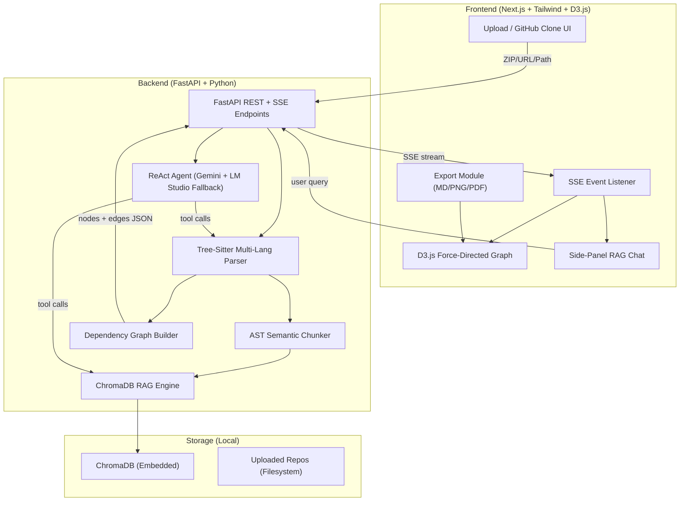

# CodeMap AI — Interactive Codebase Intelligence Agent

**Goal:** Build a full-stack AI agent that parses any codebase (Python, JS/TS, Java, C/C++, Go, Rust), generates an interactive force-directed architecture diagram, and enables a natural-language "Talk to Codebase" RAG chatbot with real-time agent reasoning visualization.

**Deadline:** October 5th, 2026 (4 days)

---

## User Review Required

> [!IMPORTANT]
> **4-Day Timeline Feasibility:** This plan is scoped for a 4-day sprint. Days are aggressive but achievable since we're using pre-researched, production-ready code patterns from our research phase. The sample project ships pre-analyzed so the demo works even if edge cases remain.

> [!WARNING]
> **GEMINI_API_KEY Required:** You will need a Google Gemini API key. The free tier of Gemini 2.0/3.8 Flash is sufficient for this project. If you don't have one yet, create it at [aistudio.google.com](https://aistudio.google.com).

> [!IMPORTANT]
> **D3.js Complexity:** You chose D3.js over React Flow. This adds ~1 day of extra development. The plan accounts for this, but be prepared for more frontend debugging than a React Flow approach.

---

## Open Questions

> [!IMPORTANT]
> **Q1: Do you have a Gemini API key already?** If not, we need to set one up before starting Day 2.

> [!IMPORTANT]
> **Q2: For the pre-built sample project, should we use a FastAPI + React todo app, or would you prefer a different sample (e.g., a Flask blog, Express API)?** This is what loads instantly when you click "Load Sample" during the demo.

---

## Architecture Overview



---

## Proposed Changes

### Component 1: Project Scaffolding & Configuration

#### [NEW] Project root structure
```
FSA-FINAL PROJECT/
├── backend/                    # FastAPI Python backend
│   ├── main.py                 # FastAPI app entry, CORS, routers
│   ├── requirements.txt        # Python dependencies
│   ├── .env.example            # Environment variable template
│   ├── core/
│   │   ├── config.py           # Settings, paths, constants
│   │   └── models.py           # Pydantic request/response models
│   ├── parser/
│   │   ├── tree_sitter_parser.py   # Multi-language AST extraction
│   │   ├── chunker.py              # AST-aware semantic code chunker
│   │   └── graph_builder.py        # Dependency graph (NetworkX)
│   ├── rag/
│   │   ├── embeddings.py       # ChromaDB + Jina embeddings setup
│   │   └── retriever.py        # Semantic search + context builder
│   ├── agent/
│   │   ├── react_agent.py      # ReAct loop (Gemini primary)
│   │   ├── tools.py            # Agent tool definitions & executor
│   │   ├── prompts.py          # System prompts
│   │   └── fallback.py         # LM Studio local fallback
│   ├── routers/
│   │   ├── upload.py           # POST /api/upload (ZIP/URL/path)
│   │   ├── graph.py            # GET /api/graph/{project_id}
│   │   ├── chat.py             # POST /api/chat/stream (SSE)
│   │   └── export.py           # GET /api/export/{format}
│   └── sample_project/         # Pre-analyzed demo codebase
│       ├── sample_data.json    # Pre-computed graph nodes/edges
│       └── src/                # Sample FastAPI todo app source
├── frontend/                   # Next.js React frontend
│   ├── package.json
│   ├── tailwind.config.ts
│   ├── next.config.ts
│   ├── tsconfig.json
│   ├── public/
│   │   └── codemap-logo.svg
│   ├── src/
│   │   ├── app/
│   │   │   ├── layout.tsx          # Root layout (dark theme, fonts)
│   │   │   ├── page.tsx            # Landing / upload page
│   │   │   └── project/
│   │   │       └── [id]/
│   │   │           └── page.tsx    # Main workspace (graph + chat)
│   │   ├── components/
│   │   │   ├── ui/
│   │   │   │   ├── Button.tsx
│   │   │   │   ├── Card.tsx
│   │   │   │   ├── FileUpload.tsx
│   │   │   │   └── LoadingSpinner.tsx
│   │   │   ├── graph/
│   │   │   │   ├── ForceGraph.tsx       # D3.js force graph component
│   │   │   │   ├── graphUtils.ts        # BFS path tracing, merge logic
│   │   │   │   ├── types.ts             # GraphNode, GraphLink types
│   │   │   │   └── NodeTooltip.tsx      # Hover/click node detail panel
│   │   │   ├── chat/
│   │   │   │   ├── ChatPanel.tsx        # Side-panel chat UI
│   │   │   │   ├── MessageBubble.tsx    # Message rendering
│   │   │   │   └── ThoughtStream.tsx    # Agent reasoning visualization
│   │   │   └── export/
│   │   │       └── ExportMenu.tsx       # Download buttons
│   │   ├── hooks/
│   │   │   ├── useSSEStream.ts          # SSE event source hook
│   │   │   └── useGraphData.ts          # Graph state management
│   │   ├── lib/
│   │   │   ├── api.ts                   # Backend API client
│   │   │   └── constants.ts             # API URLs, theme tokens
│   │   └── styles/
│   │       └── globals.css              # Tailwind + D3 animation CSS
│   └── ...
└── README.md
```

---

### Component 2: Backend — Tree-Sitter Multi-Language Parser

#### [NEW] [tree_sitter_parser.py](file:///home/mohdfaizanali/Desktop/my%20projects/FSA-FINAL%20PROJECT/backend/parser/tree_sitter_parser.py)

**What it does:**
- Uses `tree-sitter >= 0.22` with official modular grammar wheels for all 6 languages
- Extracts: functions, classes/structs/traits, imports, API endpoints (FastAPI, Express, Spring Boot, Gin, Actix)
- Uses tree-sitter S-expression queries for precise pattern matching
- Returns structured `CodeEntity` objects with name, type, line range, raw code

**Key design decisions:**
- Tree-sitter chosen over Python `ast` because it handles all 6 languages, tolerates broken/partial code, and is extremely fast (C engine)
- Each language has dedicated S-expression queries for its idioms (decorators in Python, annotations in Java, attributes in Rust)
- File extension → language mapping handles `.tsx`, `.jsx`, `.h` edge cases

---

### Component 3: Backend — AST-Aware Semantic Chunker

#### [NEW] [chunker.py](file:///home/mohdfaizanali/Desktop/my%20projects/FSA-FINAL%20PROJECT/backend/parser/chunker.py)

**What it does:**
- Splits code into embedding-ready chunks at natural AST boundaries (function, method, class)
- Enriches each chunk with contextual breadcrumbs: `# File: path | Class: Parent | Imports: [...]`
- Budget-aware recursive splitting: classes > 800 tokens split into methods; giant functions split by blocks
- Token counting via `tiktoken` (cl100k_base encoding)

**Key design decisions:**
- AST-aware chunking prevents splitting functions mid-body (unlike naive line-based splitting)
- Breadcrumb headers give the embedding model semantic context about where the code lives
- Max 600 tokens per chunk keeps embeddings sharp and retrieval precise

---

### Component 4: Backend — Dependency Graph Builder

#### [NEW] [graph_builder.py](file:///home/mohdfaizanali/Desktop/my%20projects/FSA-FINAL%20PROJECT/backend/parser/graph_builder.py)

**What it does:**
- Builds a `networkx.DiGraph` with two layers:
  1. **File-level import graph**: Which file imports which (resolves Python module paths, JS/TS imports)
  2. **Entity-level call graph**: Which function calls which function
- Detects circular dependencies
- Exports to JSON format compatible with D3.js force graph (nodes + links arrays)
- Computes topology metrics: most-depended-upon files, hub functions

**Key design decisions:**
- NetworkX chosen for its mature graph algorithms (BFS, cycle detection, centrality)
- Import resolution handles relative imports, `__init__.py`, and `node_modules` patterns
- Output JSON assigns node `type` field (`file`, `class`, `function`, `endpoint`, `database`) for D3 visual differentiation

---

### Component 5: Backend — ChromaDB RAG Engine

#### [NEW] [embeddings.py](file:///home/mohdfaizanali/Desktop/my%20projects/FSA-FINAL%20PROJECT/backend/rag/embeddings.py)
#### [NEW] [retriever.py](file:///home/mohdfaizanali/Desktop/my%20projects/FSA-FINAL%20PROJECT/backend/rag/retriever.py)

**What it does:**
- `embeddings.py`: Initializes ChromaDB PersistentClient (embedded, no server) with `jinaai/jina-embeddings-v2-base-code` embedding model (8,192 token context, trained on 30+ programming languages)
- `retriever.py`: Semantic search with metadata filtering (by language, file path, line range), returns top-k code snippets with citations, builds formatted context for the LLM

**Key design decisions:**
- Jina Code v2 chosen over `all-MiniLM-L6-v2` because MiniLM truncates at 256 tokens (cuts most functions in half) and has no code syntax awareness
- ChromaDB in embedded/persistent mode — zero infrastructure, data survives restarts
- Cosine similarity distance metric for semantic matching
- Metadata includes `file_path`, `function_name`, `language`, `start_line`, `end_line` for precise citations

---

### Component 6: Backend — ReAct Agent with Gemini + LM Studio Fallback

#### [NEW] [react_agent.py](file:///home/mohdfaizanali/Desktop/my%20projects/FSA-FINAL%20PROJECT/backend/agent/react_agent.py)
#### [NEW] [tools.py](file:///home/mohdfaizanali/Desktop/my%20projects/FSA-FINAL%20PROJECT/backend/agent/tools.py)
#### [NEW] [prompts.py](file:///home/mohdfaizanali/Desktop/my%20projects/FSA-FINAL%20PROJECT/backend/agent/prompts.py)
#### [NEW] [fallback.py](file:///home/mohdfaizanali/Desktop/my%20projects/FSA-FINAL%20PROJECT/backend/agent/fallback.py)

**What it does:**
- Implements a ReAct (Reasoning + Acting) loop using `google-genai` SDK with `gemini-3.8-flash`
- **4 custom tools** the agent can call:
  - `search_codebase(query, file_pattern)` — grep-like search across repo files
  - `get_file_content(path, start_line, end_line)` — read specific file lines
  - `generate_diagram(components)` — output Mermaid diagram from structured edges
  - `analyze_dependencies(file)` — extract imports via AST
- Streams reasoning steps via SSE in typed events: `thought`, `action`, `observation`, `answer_chunk`, `done`
- **Automatic fallback**: On Gemini quota/network errors, seamlessly switches to LM Studio (localhost:1234) using OpenAI-compatible API with the same tool definitions
- Path traversal protection: `_sanitize_path()` prevents agent from reading outside project root
- Max 8 iterations with repeated-call detection to prevent infinite loops

**Key design decisions:**
- Gemini's Interactions API used for stateful multi-turn (avoids re-sending full history each turn)
- Tool definitions use a unified JSON schema compatible with both Gemini and OpenAI/LM Studio
- SSE chosen over WebSocket for simplicity (WebSocket endpoint also available as backup)
- System prompt enforces: never hallucinate code, always verify with tools, cite file:line

---

### Component 7: Backend — FastAPI Routers

#### [NEW] [upload.py](file:///home/mohdfaizanali/Desktop/my%20projects/FSA-FINAL%20PROJECT/backend/routers/upload.py)
- `POST /api/upload` — Accepts ZIP file upload, GitHub URL, or local path
- Clones/extracts repo → runs tree-sitter parser → builds graph → indexes into ChromaDB
- Returns `project_id` for subsequent requests

#### [NEW] [graph.py](file:///home/mohdfaizanali/Desktop/my%20projects/FSA-FINAL%20PROJECT/backend/routers/graph.py)
- `GET /api/graph/{project_id}` — Returns D3-compatible JSON (`{nodes: [...], links: [...]}`)
- `GET /api/graph/sample` — Returns pre-computed sample project graph

#### [NEW] [chat.py](file:///home/mohdfaizanali/Desktop/my%20projects/FSA-FINAL%20PROJECT/backend/routers/chat.py)
- `POST /api/chat/stream` — SSE endpoint for ReAct agent chat
- Streams: `thought` → `action` → `observation` → `answer_chunk` → `done`

#### [NEW] [export.py](file:///home/mohdfaizanali/Desktop/my%20projects/FSA-FINAL%20PROJECT/backend/routers/export.py)
- `GET /api/export/markdown/{project_id}` — ARCHITECTURE.md with Mermaid diagrams
- `GET /api/export/api-docs/{project_id}` — Auto-generated API documentation
- `GET /api/export/diagram/{project_id}` — PNG/SVG of the graph
- `GET /api/export/pdf/{project_id}` — Full PDF report

---

### Component 8: Frontend — Next.js Landing Page & Upload

#### [NEW] [page.tsx](file:///home/mohdfaizanali/Desktop/my%20projects/FSA-FINAL%20PROJECT/frontend/src/app/page.tsx) (Landing)
- Hero section with project name, tagline, and 3 input options:
  1. **Drag & drop ZIP** upload zone
  2. **GitHub URL** input field with "Clone" button
  3. **Local path** input field
- "Load Sample Project" button for instant demo
- Dark theme with gradient accents

---

### Component 9: Frontend — D3.js Interactive Force Graph

#### [NEW] [ForceGraph.tsx](file:///home/mohdfaizanali/Desktop/my%20projects/FSA-FINAL%20PROJECT/frontend/src/components/graph/ForceGraph.tsx)

**What it does:**
- D3.js force-directed graph rendered inside a React component (Pattern B: React as container, D3 controls inner DOM)
- **Custom node shapes by entity type:**
  - File → Rounded rectangle (Cyan `#38bdf8`)
  - Class → Diamond polygon (Violet `#a855f7`)
  - Function → Circle (Emerald `#10b981`)
  - Endpoint → Pill/capsule (Amber `#f59e0b`)
  - Database → Hexagon (Rose `#f43f5e`)
- **SVG glow filters** (`feGaussianBlur` + `feMerge`) for neon cyberpunk aesthetic
- **Animated edges** with `stroke-dasharray` CSS animation for data flow visualization
- **Directional arrows** via SVG `<marker>` definitions
- **Zoom/pan** via `d3.zoom()` with scale extent [0.15, 4]
- **Drag** nodes with physics reheat (`alphaTarget(0.3)`)
- **Path highlighting**: BFS traversal dims unrelated nodes to `opacity: 0.12`, highlights active path with intense glow and rapid dash animation
- **Click handlers** communicate selected node to React state for detail panel
- **Dynamic data updates**: Merges new nodes with existing coordinates to prevent "physics explosion" bug
- Dot-grid background pattern for professional dark aesthetic

#### [NEW] [graphUtils.ts](file:///home/mohdfaizanali/Desktop/my%20projects/FSA-FINAL%20PROJECT/frontend/src/components/graph/graphUtils.ts)
- `tracePath(startId, endId, links)` — BFS path finding, returns active node/link ID sets
- `mergeGraphData(oldNodes, newData)` — Preserves x/y/vx/vy coordinates during data refresh

#### [NEW] [types.ts](file:///home/mohdfaizanali/Desktop/my%20projects/FSA-FINAL%20PROJECT/frontend/src/components/graph/types.ts)
- TypeScript interfaces: `GraphNode`, `GraphLink`, `GraphData`, `PathTraceResult`

---

### Component 10: Frontend — Chat Panel with Agent Reasoning Stream

#### [NEW] [ChatPanel.tsx](file:///home/mohdfaizanali/Desktop/my%20projects/FSA-FINAL%20PROJECT/frontend/src/components/chat/ChatPanel.tsx)
- Side-panel (right side) with message history and input field
- Renders different message types: user messages, agent responses, code blocks with syntax highlighting

#### [NEW] [ThoughtStream.tsx](file:///home/mohdfaizanali/Desktop/my%20projects/FSA-FINAL%20PROJECT/frontend/src/components/chat/ThoughtStream.tsx)
- Real-time visualization of agent's ReAct steps:
  - 🧠 **Thought** — Agent's reasoning (dimmed, italic)
  - 🔧 **Action** — Tool being called with arguments
  - 👁 **Observation** — Tool result summary
  - ✅ **Answer** — Final streamed response
- Collapsible step cards with expand/collapse for detail

#### [NEW] [useSSEStream.ts](file:///home/mohdfaizanali/Desktop/my%20projects/FSA-FINAL%20PROJECT/frontend/src/hooks/useSSEStream.ts)
- Custom React hook using `EventSource` API
- Parses SSE events (`thought`, `action`, `observation`, `answer_chunk`, `done`)
- Updates chat state and optionally highlights graph nodes when agent references them

---

### Component 11: Frontend — Export Module

#### [NEW] [ExportMenu.tsx](file:///home/mohdfaizanali/Desktop/my%20projects/FSA-FINAL%20PROJECT/frontend/src/components/export/ExportMenu.tsx)
- Dropdown menu with 4 export options: ARCHITECTURE.md, API Docs, PNG/SVG, PDF
- Triggers backend export endpoints and downloads the file

---

### Component 12: Sample Demo Project

#### [NEW] `backend/sample_project/`
- A small but realistic FastAPI + SQLAlchemy todo app (~8 files)
- Pre-computed `sample_data.json` with graph nodes, edges, and ChromaDB index
- Loads instantly when user clicks "Load Sample Project"

---

## Technology Stack Summary

| Layer | Technology | Why |
|---|---|---|
| **Backend** | FastAPI (Python 3.11+) | Async, SSE support, fast, great DX |
| **Code Parsing** | tree-sitter 0.22+ (modular wheels) | Multi-language, error-tolerant, C-speed |
| **Graph Engine** | NetworkX | Mature graph algorithms (BFS, cycles, centrality) |
| **Vector DB** | ChromaDB (embedded persistent) | Zero infrastructure, in-process |
| **Embeddings** | Jina Embeddings v2 Base Code (161M) | 8K context, 30+ code languages |
| **LLM (Primary)** | Gemini 3.8 Flash (google-genai SDK) | 1M context, free tier, fast |
| **LLM (Fallback)** | LM Studio (Qwen 2.5 Coder 7B) | Offline, OpenAI-compatible API |
| **Frontend** | Next.js 14 + React 18 + Tailwind CSS | Modern, fast, SSR-capable |
| **Diagrams** | D3.js (force simulation) | Full control, SVG filters, animations |
| **Streaming** | Server-Sent Events (SSE) | Simple, reliable, one-way stream |

---

## Sprint Schedule (4 Days)

### Day 1 (Oct 2) — Backend Core: Parser + Graph + RAG
- [ ] Project scaffolding (backend + frontend)
- [ ] `tree_sitter_parser.py` — Multi-language entity extraction
- [ ] `chunker.py` — AST-aware semantic chunking
- [ ] `graph_builder.py` — Dependency graph + JSON export
- [ ] `embeddings.py` + `retriever.py` — ChromaDB RAG pipeline
- [ ] Unit tests for parser and chunker

### Day 2 (Oct 3) — Backend Agent + API + Frontend Shell
- [ ] `react_agent.py` — ReAct loop with Gemini
- [ ] `tools.py` — 4 agent tools with path sanitization
- [ ] `fallback.py` — LM Studio fallback
- [ ] FastAPI routers: upload, graph, chat/stream, export
- [ ] Next.js project setup (Tailwind, dark theme, layout)
- [ ] Landing page with upload UI
- [ ] API client (`lib/api.ts`)

### Day 3 (Oct 4) — Frontend Graph + Chat + Integration
- [ ] `ForceGraph.tsx` — D3.js force graph with all visual features
- [ ] `graphUtils.ts` — BFS path tracing
- [ ] `ChatPanel.tsx` + `ThoughtStream.tsx` — Chat with reasoning stream
- [ ] `useSSEStream.ts` — SSE hook
- [ ] Wire frontend ↔ backend end-to-end
- [ ] Sample project data loading
- [ ] Export functionality

### Day 4 (Oct 5) — Polish, Demo Prep, Presentation
- [ ] Bug fixes and edge cases
- [ ] UI polish (animations, transitions, responsive)
- [ ] Create pre-analyzed sample project
- [ ] Test full demo flow 3x
- [ ] Prepare PowerPoint presentation
- [ ] Record backup demo video (in case of live demo issues)

---

## Verification Plan

### Automated Tests
```bash
# Backend tests
cd backend && python -m pytest tests/ -v

# Type checking
cd frontend && npx tsc --noEmit
```

### Manual Verification
1. **Upload flow**: Upload a ZIP → verify graph renders with correct nodes/edges
2. **GitHub clone**: Paste a GitHub URL → verify repo is cloned and parsed
3. **Chat**: Ask "Where is the authentication logic?" → verify agent calls search_codebase, returns cited answer
4. **Path highlighting**: Click "Trace flow" → verify BFS highlights path on graph
5. **Fallback**: Disconnect internet → verify LM Studio fallback activates
6. **Export**: Download ARCHITECTURE.md → verify it contains Mermaid diagrams
7. **Sample project**: Click "Load Sample" → verify instant graph + chat readiness

### Demo Rehearsal
- Run complete demo flow 3 times on localhost before presentation
- Record a backup screen recording as safety net
